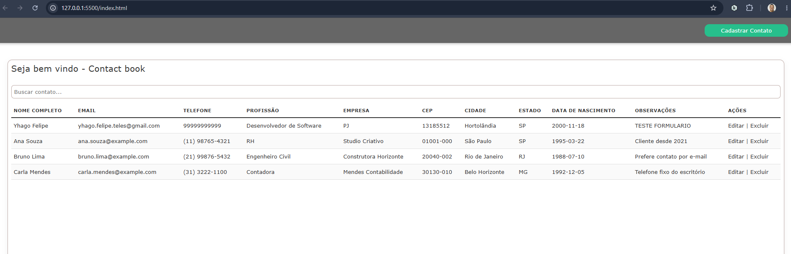

# Vanilla JS Contact Book

Agenda de contatos em HTML, CSS e JavaScript puro, sem framework, biblioteca ou etapa de build.

É um projeto de prática para manter os fundamentos em dia. A ideia é resolver na mão o que normalmente fica a cargo de um framework, renderização a partir do estado, controle de formulário, persistência, integração com API externa e layout responsivo.



## Funcionalidades

- Cadastro, edição e exclusão de contatos
- Busca que filtra a lista enquanto você digita, em todos os campos
- Persistência em `localStorage`
- Preenchimento de cidade e estado a partir do CEP, via [ViaCEP](https://viacep.com.br)
- Validação de campos obrigatórios, e-mail e telefone, com mensagens de erro na interface
- Tabela que vira lista de cartões em telas menores

## Decisões técnicas

- **Estado como fonte da verdade.** Um array em memória guarda os contatos e é sincronizado com o `localStorage` a cada alteração. A tabela é reconstruída a partir dele, nunca editada diretamente.
- **Renderização segura.** As linhas são montadas com `createElement` e `textContent`, então o que o usuário digita nunca é interpretado como HTML.
- **Operações por id, não por índice.** Cada contato recebe um `crypto.randomUUID()`. Edição e exclusão usam `find`, `findIndex` e `filter` pelo id, o que mantém as ações corretas mesmo com a lista filtrada pela busca.
- **Um formulário para criar e editar.** Um `editingId` define se o envio cria um contato novo ou atualiza um existente.
- **Validação própria.** O formulário usa `novalidate`, e as regras ficam no JS: regex para e-mail e para telefone com DDD (10 ou 11 dígitos). O erro aparece no próprio formulário.
- **Integração com ViaCEP.** O CEP é normalizado para 8 dígitos antes da requisição. Carregando, CEP inexistente e falha de rede têm cada um sua mensagem.
- **Responsividade sem marcação duplicada.** Abaixo de 1200px a tabela vira cartões usando `data-label` em cada célula e `td::before` para exibir o rótulo.
- **Acessibilidade.** Inputs dentro de `<label>`, ações como `<button>` e mensagens dinâmicas anunciadas com `aria-live`.

## Stack

HTML5, CSS3 e JavaScript (ES2022), sem dependências.

## Como rodar

```bash
git clone https://github.com/yyhago/vanilla-js-contact-book.git
```

Abra o `index.html` direto no navegador ou sirva a pasta com qualquer servidor local, como o Live Server do VS Code. O `crypto.randomUUID()` exige contexto seguro, o que inclui `file://` e `localhost`.
